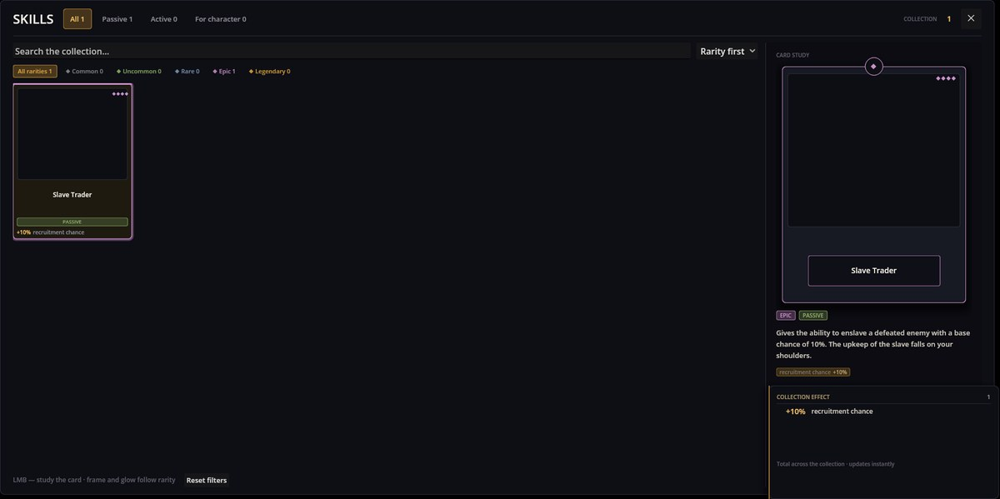

# Skills Engine — 玩家的技能卡收藏

Skills Engine 保存玩家收集到的技能，并以卡片形式显示在**技能**面板中。一个技能可以开启其他机制中的可能性（被动"大门"），给玩家发放新的战斗行动卡，并把数值累加进**收藏效果**——所有已收集技能的总和。

它是 Cthangover 的一部分：游戏开局时玩家就带有一个技能——**奴隶贩子**。

## 技能面板

用工具栏上的技能图标打开。



- **页签**按类型筛选——**被动**、**主动**、**角色专属**——稀有度一行按稀有度筛选，从**普通**到**传说**；搜索框和排序列表可以缩小网格范围。
- **边框颜色和菱形标记**表示卡片的稀有度。
- **点击一张卡**可在卡牌研读区查看它：图片、稀有度和类型徽章、描述、它的效果，以及（若技能授予行动卡）它给出的那张行动卡。
- **收藏效果**把所有已收集技能的效果加在一起：一个 +10%、一个 +5% 俘虏几率的技能会显示 +15%。

"奴隶贩子"这张卡暂时没有图片：游戏指定 `characters/skills/slave_master` 作为它的图片，但没有任何 mod 提供这个文件，所以边框一直空着。

## 技能的定义

技能是类型为 `skill` 的 JSON 文件，放在 mod 的任何位置。这是 Cthangover 的奴隶贩子——可与上面的面板对照：

```json
{
  "Kind": "skill",
  "Items": [
    {
      "Id": "slave_master",
      "Name": "characters/skills/slave_master_name",
      "Description": "characters/skills/slave_master",
      "Image": "characters/skills/slave_master",
      "Type": 1,
      "Rare": 3,
      "Effects": [
        { "Key": "characters/skills/effects/recruit", "Value": 10, "Percent": true }
      ]
    }
  ]
}
```

- `Name`、`Description` — 翻译键。
- `Image` — 卡片图片。
- `Type` — `Active`（0）、`Passive`（1）或 `ForCharacter`（2）；名称或数字都可以。奴隶贩子是**被动**。
- `Rare` — `Common`（0）、`Uncommon`、`Rare`、`Epic`（3）、`Legendary`。奴隶贩子是**史诗**。
- `Effects` — 供收藏效果累计的数值：`Key` 是所加成内容的翻译键，`Value` 是数值，`Percent` 决定是否按百分比显示。同一个键在所有技能里必须使用同一单位，因为这些数值要相加。
- `GrantsAction`（可选）— 一张行动卡的 id（见 Characters Engine）。获得技能的同时，这张卡也会进入"角色行动"面板的行动卡池。

## 技能在游戏里做什么

面板只负责展示技能。技能真正改变什么，由检查它的那些 mod 决定：

- 只有当玩家拥有 `slave_master` 时，recruiting 才会提供**奴役**被击败敌人的选项。成功率是敌人自身的 `RecruitmentChance`；卡片上的 +10% 只显示在面板里，recruiting 并不会把它加进去。
- 带 `GrantsAction` 的技能会给出它的行动卡，玩家随后可以把它放进角色的栏位。

## 从剧本授予技能

```scenario
action character.add_skill skill_id=slave_master
```

重复授予同一个技能不会有任何效果，所以重复播放的场景不会复制技能或它的行动卡。Cthangover 在新游戏开始时授予奴隶贩子。

## 出问题时

1. **技能没有出现。** `skill_id` 必须与技能的 `Id` 一致；未知 id 会作为警告写入日志。
2. **卡片没有图片。** 没有 mod 提供 `Image` 里所写名称的图片。
3. **收藏效果显示出奇怪的总数。** 两个技能用了相同的效果键但 `Percent` 值不同。
